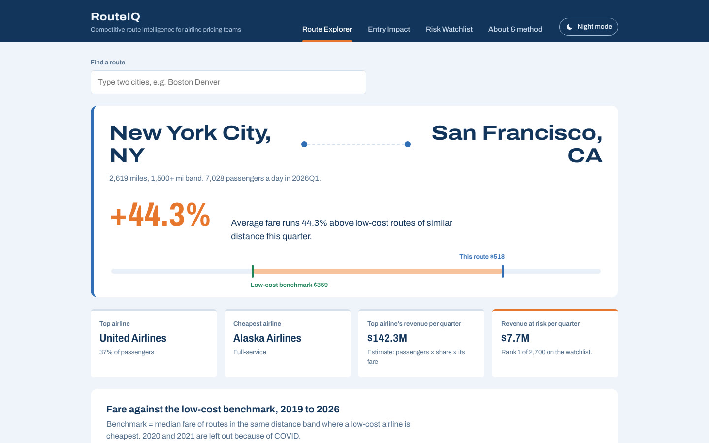
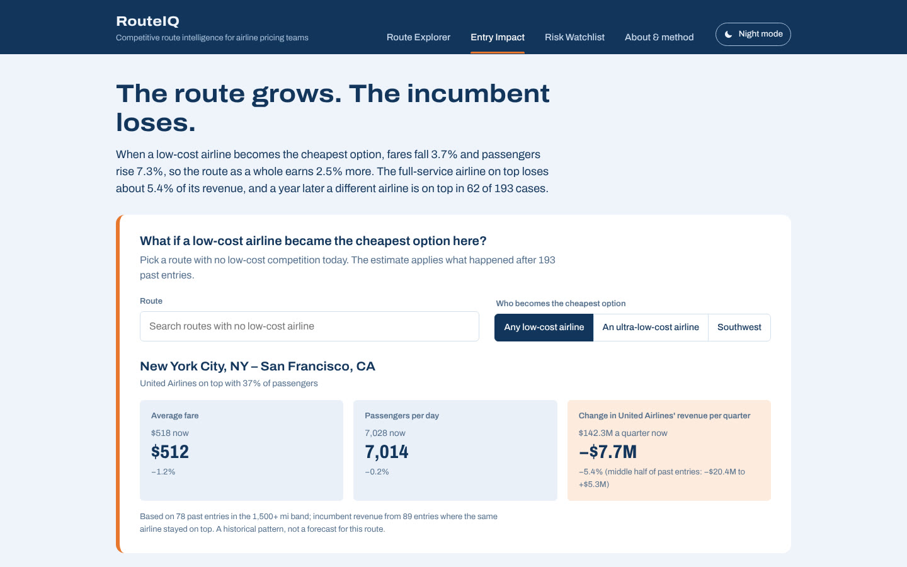
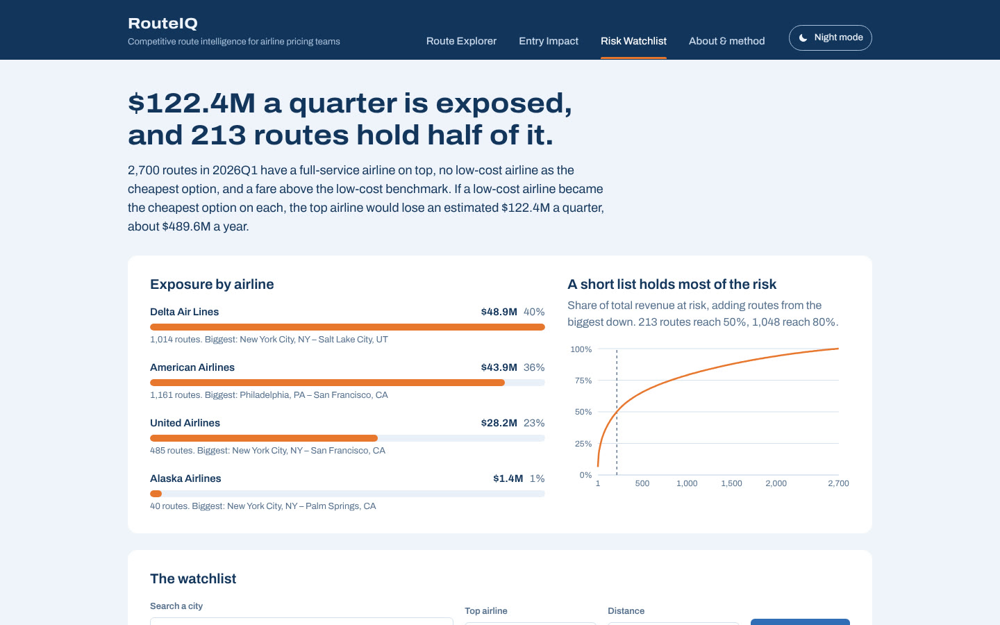
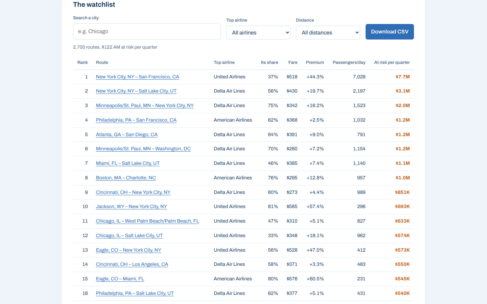
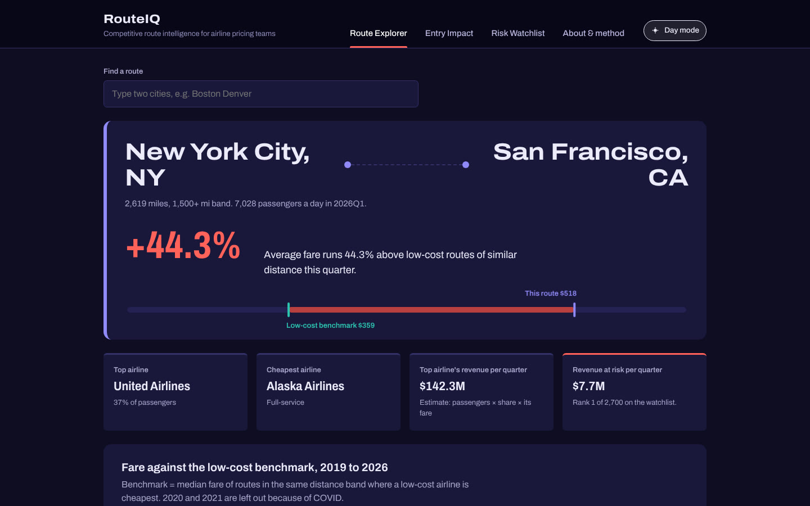

# The Competition Discount

**What a low-cost airline costs the incumbent when it becomes the cheapest option on a route, and which routes are most exposed next**

A pricing analysis of every US domestic city-pair route from 2019 to 2026. It measures the fare premium full-service airlines charge where no low-cost airline competes, estimates what happens to that premium (and to the incumbent's revenue) once one does, and ranks the routes where the most revenue is at risk. The results ship as **RouteIQ**, a live tool built for an airline pricing team.

> **About the data:** US Department of Transportation, *Domestic Airline Consumer Airfare Report*, Table 6 (data.transportation.gov, dataset `yj5y-b2ir`). This is real, public, government-published data: one row per US city-pair market per quarter (markets with 10+ passengers a day), with average fare, passengers, distance, and the largest and cheapest airline on each route. 167,884 route-quarters across 8,474 routes, 2019 Q1 to 2026 Q1. Revenue figures in this project are **estimates** built from average fares and passenger counts, not airline accounting data.

**Tools:** Python (pandas, Google Colab) · PostgreSQL (Supabase) · React + Vite + Recharts (live tool on Vercel)
**Techniques:** API data acquisition, data validation against published figures, benchmark pricing, difference-in-differences with control routes, event detection with SQL window functions, Pareto analysis

---

## [Live tool: RouteIQ](https://routeiq-airline-pricing.vercel.app) · [30-second demo video](assets/routeiq-demo.mp4) · [Full findings](FINDINGS.md)



---

## The headline

| Metric | Value |
|---|---|
| Route-quarters analysed | 167,884 (8,474 routes, 2019 Q1 to 2026 Q1) |
| Fare premium where no low-cost airline is the cheapest option, 2026 Q1 | **12.8%** (peak 33.2% in 2022 Q3) |
| Clean low-cost entry events studied | 193 (2023 Q1 to 2025 Q1) |
| After an entry: fares / passengers / route revenue | −3.7% / +7.3% / +2.5% |
| After an entry: incumbent's own revenue (same airline on top throughout) | **−5.4%** |
| Top airline different a year after entry | 62 of 193 (32%) |
| Revenue at risk on the 2,700 watchlist routes | **$122.4M a quarter** (about $490M a year) |
| Routes holding half of that risk | **213** |

**The conclusion in one sentence:** when a low-cost airline becomes the cheapest option, the route grows but the full-service incumbent loses, about 5% of its revenue where it keeps the top spot and, in one case in three, the top spot itself; across the routes still charging a premium that is about $122M a quarter, and half of it sits on just 213 routes.

---

## Contents

- [Business context](#business-context)
- [Business questions](#business-questions)
- [The dataset](#the-dataset)
- [Analysis walkthrough](#analysis-walkthrough)
- [The tool: RouteIQ](#the-tool-routeiq)
- [Exceptions and limitations](#exceptions-and-limitations)
- [Recommendations](#recommendations)
- [Method](#method)
- [Repository structure](#repository-structure)
- [About](#about)

---

## Business context

Full-service airlines can charge more on routes where nobody undercuts them. That premium is valuable and fragile: when a low-cost airline arrives, fares fall, the market grows, and the incumbent has to decide how to respond. A pricing and revenue-management team needs three things before that happens: how big its premium really is, what an entry has historically cost an airline in its position, and which of its routes carry the most exposure.

The stakeholder framed here is the **Director of Pricing & Revenue Management at a full-service US airline**, deciding where to focus competitive monitoring and how to respond to new entrants.

## Business questions

1. **The premium:** how much more do full-service routes charge than comparable low-cost routes, and is that premium growing or shrinking?
2. **The entry effect:** when a low-cost airline becomes the cheapest option on a route, what happens to fares, passengers, route revenue, and the incumbent's own revenue?
3. **The watchlist:** which routes still charging a premium have the most revenue at risk if that happens next?

## The dataset

**Source:** US DOT *Domestic Airline Consumer Airfare Report*, Table 6, downloaded through the public Socrata API in pages of 50,000 rows.

**Why this dataset:** it is the only free, public source that covers every sizeable US domestic route every quarter with fares and the identity of both the largest and the cheapest airline, which is exactly what a competitive-pricing question needs.

| | |
|---|---|
| Rows downloaded | 167,886 (2019 Q1 to 2026 Q1, 29 quarters) |
| Rows after cleaning | 167,884 (2 malformed duplicates removed) |
| Routes (city pairs) | 8,474 |
| Grain | one route in one quarter; `(route_id, period_index)` is unique |
| Low-cost airlines | Southwest, Allegiant, Frontier, Spirit, Breeze, Sun Country, Avelo (JetBlue tested separately) |
| Full-service airlines | American, Delta, United, Alaska, Hawaiian |

**Validation:** route counts match DOT's published reports for 2020 Q1 (5,412), 2023 Q2 (6,084) and 2025 Q1 (6,048). Every handoff (download → clean CSV → Supabase) was reconciled, and every check matched.

## Analysis walkthrough

### Step 1 — Acquire the data (Python)

Pulled Table 6 from data.transportation.gov through its API, checked the server's row count per year before downloading, and saved the raw file to Drive so a Colab reset never forces a re-download. See [`notebooks/01_get_the_data.ipynb`](notebooks/01_get_the_data.ipynb).

### Step 2 — Inspect and clean (Python)

Found and removed 2 duplicate rows with malformed keys, dropped 10 empty map columns, and checked for impossible values (none: no zero fares or distances, market shares all between 0 and 1). Grouped every airline as full-service, low-cost, hybrid or regional, then added the fields the analysis needs: distance band, a COVID flag for 2020–2021, fare per mile, a consecutive quarter index, and revenue estimates for the route and for its top airline. Saved 167,884 rows × 30 columns. See [`notebooks/02_clean_and_prepare.ipynb`](notebooks/02_clean_and_prepare.ipynb).

### Step 3 — Load and check the structure (SQL, PostgreSQL/Supabase)

Loaded the clean table into Postgres with a primary key that enforces the grain and check constraints on the key numbers ([`sql/01_schema.sql`](sql/01_schema.sql)). Then checked route histories for gaps with `LAG` over a quarter index: 7.6% of rows follow a skipped quarter, so every later comparison uses consecutive quarters only. Routes present in all 29 quarters are a quarter of all routes but carry 89.3% of passengers ([`sql/02_validation.sql`](sql/02_validation.sql)).

### Step 4 — Measure the premium

For each route and quarter, the **benchmark fare** is the median fare of routes in the same distance band and quarter where a low-cost airline is the cheapest option. The **fare premium** is how far a route's fare sits above that benchmark. Full-service routes carry a premium in every distance band, largest at 500–1,500 miles (24–26% passenger-weighted). The premium was about 15% in 2019, peaked at 33.2% in 2022 Q3, and has fallen to 12.8% in 2026 Q1 ([`sql/03_premium.sql`](sql/03_premium.sql)).

### Step 5 — Find clean entry events

An **entry event** is a quarter where the cheapest airline on a route switches from full-service to low-cost and stays low-cost the next quarter (checked with `LAG` and `LEAD`), with 4 clean full-service quarters before, 4 quarters after, no gaps and no COVID quarters. 193 of 4,649 candidate switches pass those rules ([`sql/04_entry_events.sql`](sql/04_entry_events.sql)).

### Step 6 — Measure the entry effect (difference-in-differences)

Compared each route's change from the year before to the year after entry with the change on similar routes in the same distance band that had no entry, so market-wide moves (fuel, demand, inflation) cancel out. Fares fell 3.7%, passengers rose 7.3% and route revenue rose 2.5%. Where the same airline stayed on top throughout (89 events), its own revenue fell a median 5.4% ([`sql/05_entry_effect.sql`](sql/05_entry_effect.sql)).

### Step 7 — Build the watchlist

Took every route in 2026 Q1 with a full-service airline on top, no low-cost airline as the cheapest option and a fare above the benchmark: 2,700 routes. **Revenue at risk** is the top airline's estimated quarterly revenue × 5.4%. Ranked with `RANK()`, then a running `SUM()` shows how concentrated the risk is: 213 routes hold half of the $122.4M ([`sql/06_watchlist.sql`](sql/06_watchlist.sql)).

### Step 8 — Test the result

Split entries by competitor type: ultra-low-cost entrants cut fares 13.5% and grow passengers 26.7%; Southwest barely moves fares (−0.2%) but takes share, and the incumbent loses 8.4%. Counting JetBlue as low-cost gives 204 events and an incumbent loss of 5.2%, the same picture ([`sql/07_robustness.sql`](sql/07_robustness.sql)).

### Step 9 — Ship it as a tool (React)

Exported the three result sets as static JSON and built **RouteIQ**, a React app deployed on Vercel, so a pricing analyst can look up any route instead of reading a report.

---

## The tool: RouteIQ

**Use it live:** **[RouteIQ](https://routeiq-airline-pricing.vercel.app)**. Three screens, one for each business question, plus a method page. Screenshots below in case the link is ever down.

**Route Explorer:** search any US route to see its fare against the low-cost benchmark, its top and cheapest airlines, and its revenue at risk.


**Entry Impact:** pick a route with no low-cost competition and see what past entries suggest would happen to its fare, passengers and the top airline's revenue, by type of entrant.



**Risk Watchlist:** exposure by airline, the concentration curve, and a ranked, filterable table of all 2,700 routes with a CSV download.





It has a day and a night theme:



---

## Exceptions and limitations

- **US domestic data only.** The method carries over to Canadian routes; the numbers do not.
- **"Becomes the cheapest option"** covers both a new entry and a low-cost airline already on the route cutting fares. The data can't separate them.
- **Only the largest and the cheapest airline are visible on each route.** A low-cost airline flying at a higher fare is invisible, and so is any airline in between.
- **Small samples by distance band** (28–78 events per band). Band figures are directional; the overall figures are the main result.
- **Association, not proof of cause.** Low-cost airlines choose which routes to enter. The control routes remove market-wide moves but not that choice.
- **Revenue is estimated** from average fares (taxes, fees and first class included). It is fit for ranking routes, not for accounting.
- **Revenue at risk is the expected loss if an entry happens**, not the probability that one will.
- **The dominant airline can change after an entry**, so the headline incumbent loss (−5.4%) uses only the 89 events where the same airline stayed on top; the −9.0% "top airline revenue" figure mixes different airlines.

## Recommendations

| # | Action | Basis |
|---|---|---|
| 1 | Put the **top 213 watchlist routes** on a quarterly competitive review with a pre-agreed response plan, starting with New York–San Francisco | 213 routes hold half of the $122.4M quarterly risk; NYC–SFO alone is $7.7M |
| 2 | **Respond by competitor type**, not with blanket fare cuts: protect the higher-paying segment against ultra-low-cost entrants; use non-price levers against Southwest | Ultra-low-cost entries cut fares 13.5% but the market grows 26.7%; Southwest entries barely move fares (−0.2%) yet cost the incumbent 8.4% |
| 3 | **Re-baseline pricing targets and forecasts** for a thinner premium, prioritising 500–1,500-mile routes | The premium fell from 33.2% (2022 Q3) to 12.8% (2026 Q1); mid-distance routes carry the largest premium and the largest post-entry losses |

Expected impact and measurement for each recommendation are in [FINDINGS.md](FINDINGS.md#recommendations).

## Method

**Approach:** frame the pricing decision → validate real public data against published figures → build a like-for-like benchmark → measure the effect of competition against control routes → turn the result into a ranked list a team can act on → ship it as a tool.

**Validation:** row and total reconciliation at every handoff; route counts checked against DOT's own reports; the headline effect re-run with a different low-cost definition (JetBlue included) and split by competitor type, with the same conclusion.

**Techniques used:**

| Technique | Applied in |
|---|---|
| API acquisition with paging and checkpoints | `notebooks/01_get_the_data.ipynb` |
| Data-quality checks and a data-quality log | `notebooks/02_clean_and_prepare.ipynb` |
| Schema design with a grain-enforcing primary key | `sql/01_schema.sql` |
| Gap detection with `LAG` over a quarter index | `sql/02_validation.sql` |
| Benchmark pricing with `percentile_cont` | `sql/03_premium.sql` |
| Event detection with `LAG` / `LEAD` | `sql/04_entry_events.sql` |
| Difference-in-differences against control routes | `sql/05_entry_effect.sql` |
| Ranking and Pareto analysis with `RANK()` and running `SUM()` | `sql/06_watchlist.sql` |
| Sensitivity checks | `sql/07_robustness.sql` |
| Interactive tool (React, Vite, Recharts) | `routeiq/` |

## Repository structure

```
the-competition-discount/
├── README.md                     # This file
├── FINDINGS.md                   # Full findings, recommendations, robustness, limitations
├── notebooks/
│   ├── 01_get_the_data.ipynb     # Python: download from the DOT API, validate counts
│   └── 02_clean_and_prepare.ipynb # Python: inspect, clean, derive fields, save clean table
├── sql/
│   ├── 01_schema.sql             # Table, constraints, indexes
│   ├── 02_validation.sql         # Gaps and route-history checks
│   ├── 03_premium.sql            # Q1: benchmark and fare premium
│   ├── 04_entry_events.sql       # Q2: finding clean entry events
│   ├── 05_entry_effect.sql       # Q2: difference-in-differences
│   ├── 06_watchlist.sql          # Q3: revenue at risk and ranking
│   └── 07_robustness.sql         # Competitor-type split, JetBlue check
├── scripts/
│   └── prepare_app_data.py       # Compacts the SQL exports into the app's JSON files
├── routeiq/                      # The live tool (React + Vite, deployed on Vercel)
│   ├── src/
│   ├── public/data/              # routes.json, entry_events.json, watchlist.json
│   └── package.json
└── assets/
    ├── routeiq-demo.mp4          # 30-second walkthrough
    └── *.jpg                     # Screenshots
```

**Run the tool locally:** `cd routeiq && npm install && npm run dev`

---

## About

**Shubham Sarje** — Data & Business Analyst, Toronto

**Approach:** Start from the pricing decision a team has to make, then let the data decide how confident that decision can be.

**Background:** Accounting-trained (B.Com) with dual post-graduate analytics credentials (4.0 GPA, Durham College) — which is why margin, cost structure, and profitability analysis are natural territory. Currently a Technical & Customer Experience Analyst at Transcom.

**Toolkit:** SQL (PostgreSQL) · Power BI · Tableau · Excel *(certified)* · Python

[LinkedIn](https://linkedin.com/in/shubhamsarje) · shubham.s.sarje@gmail.com · Toronto, ON
